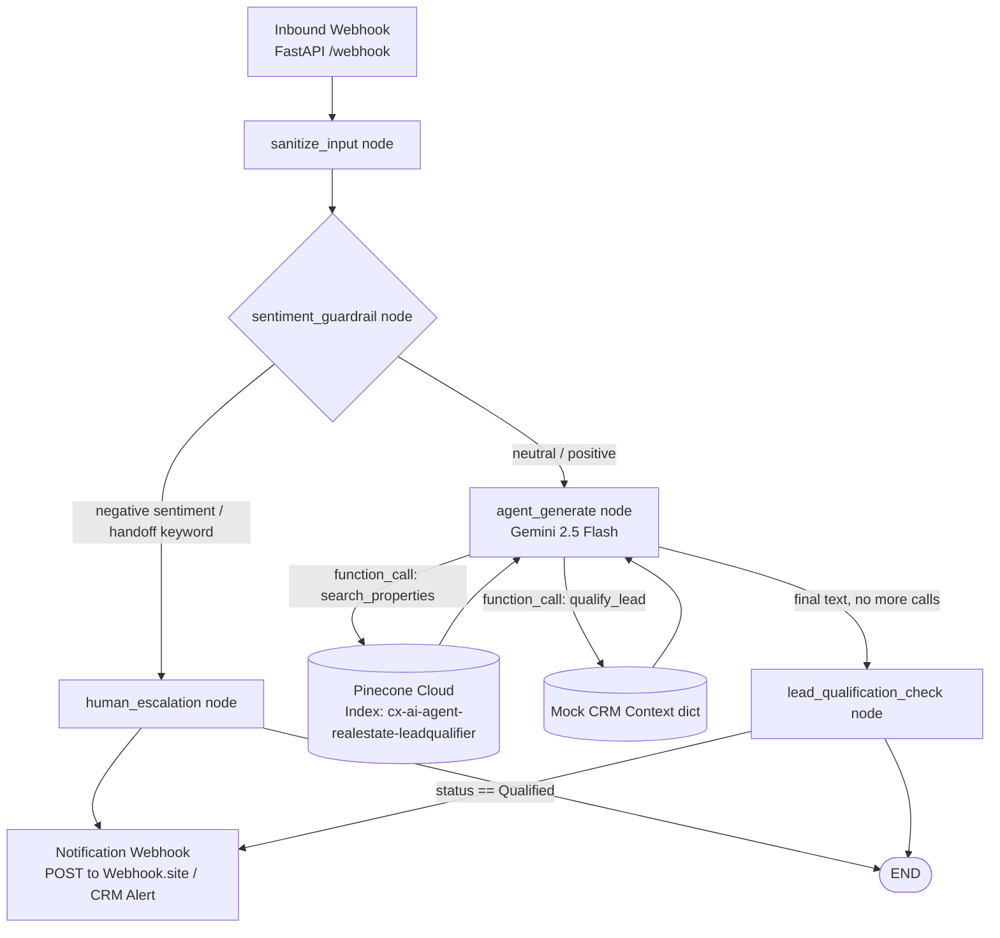
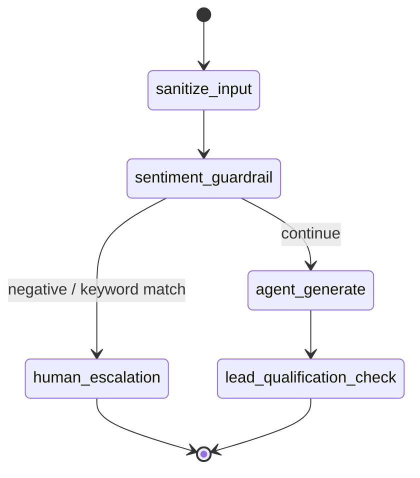

# Dubai Luxury Concierge — Guardrailed Hybrid Agent (POC)

An AI concierge built specifically to be trusted by a relationship-driven, brand-protective
Dubai real estate agency — not just to automate chat.

This README is split into two reading tracks. Jump to whichever fits you:

- [👔 Persona A — For the Founder / Business Stakeholder](#persona-a--for-the-founder--business-stakeholder)
- [🛠️ Persona B — For the Systems Engineer](#persona-b--for-the-systems-engineer)

---

## Persona A — For the Founder / Business Stakeholder

### Executive Summary

Luxury real estate is sold on trust, polish, and a human touch — which is exactly why most
agencies in this market have rejected AI chatbots outright. This POC isn't a generic chatbot.
It's a **guardrailed concierge** that behaves like your best-trained junior associate: it never
invents facts, it never embarrasses the brand, and it knows exactly when to get out of the way
and hand the conversation to a real person.

### 🔥 Systematically Defeating the 3 Core Stigmas of AI Automation

**1. Attribution Risk (losing credit/control over a lead)**
Every qualified lead — once the system has naturally learned the client's preferred location,
budget, and timeline — is written to a CRM record and pushed as a structured alert directly to
your team's phone. Nothing about the conversation disappears into a black box; your team sees
the full picture the moment it matters.

**2. Hallucination Liability (the bot inventing a price or a fact)**
Think of the agent as an expert concierge standing behind a **locked corporate filing cabinet**
(the vector database of your real inventory). The concierge is physically incapable of quoting a
price it hasn't pulled from that cabinet. If the cabinet doesn't have the answer, the concierge
says so gracefully and loops in a human — it never guesses.

**3. Customer Alienation ("AI slop")**
The agent is instructed, line by line, to speak like a senior private client advisor: warm,
concise, confident, bilingual. The moment a client sounds frustrated or explicitly asks for a
human, a silent "circuit breaker" trips and routes them to a real advisor before the AI ever gets
a chance to make things worse.

### 🎯 The Safe Hybrid Concierge Blueprint

```
Client message
     │
     ▼
Is the client frustrated or asking for a human?  ──Yes──▶  Hand off to your team instantly
     │ No
     ▼
Does this question need a real property fact?  ──Yes──▶  Pull it from the locked inventory file
     │                                                     (never guessed, never invented)
     ▼
Has the client shared where, how much, and when?  ──Yes──▶  Log as a Qualified Lead +
     │ No                                                    push alert to your phone
     ▼
Continue the warm, natural conversation
```

Two systems work together:
- **RAG (Retrieval-Augmented Generation)** — the "locked filing cabinet." The AI retrieves the
  exact, current property record before saying anything specific, instead of relying on memory.
- **Deterministic Graph Workflow** — a fixed flowchart (not a loose AI improvisation) that
  guarantees the sentiment check and the human-handoff rule run on *every single message*, with
  no way for the model to skip them.

### 🚀 Core Business Impact KPIs

| KPI | What it measures | Why it matters |
|---|---|---|
| **Escalation Latency** | Time from frustration signal to human handoff | Protects brand reputation in real time |
| **Hallucination Rate** | % of property answers not grounded in verified inventory | Target: 0% — removes legal/compliance exposure |
| **Lead Qualification Rate** | % of conversations reaching a complete lead dossier | Direct pipeline contribution |
| **Time-to-Notify** | Time from "Qualified" status to advisor's phone alert | Speed-to-lead is the #1 driver of luxury close rates |
| **Infrastructure Cost** | Runs entirely on free-tier/open-source components for this POC | Proves the model before committing budget |

---

## Persona B — For the Systems Engineer

### Architecture Topology



### State Flow (LangGraph nodes)



### Why these nodes are hard-coded, not left to the LLM

| Node | Guarantee |
|---|---|
| `sanitize_input` | Strips control characters, caps length, neutralizes known prompt-injection phrasing *before* it ever reaches the model or the persisted state. |
| `sentiment_guardrail` | A zero-latency, dependency-free lexicon/heuristic scorer (no LLM round-trip) that runs on **every** message. Keyword matches (e.g. "talk to a agent") hard short-circuit the generator — this is a structural graph edge, not a prompt instruction the model could ignore. |
| `agent_generate` | Gemini 2.5 Flash with two bound tools (`search_properties`, `qualify_lead`). The system instruction forbids answering property questions without a tool call, and the tool itself is backed by a serverless Pinecone cloud index registry leveraging 768-dimension dense vector matches via gemini-embedding-001. No local infrastructure runtime layer or cold start exists. — there is no code path where a fact reaches the user without passing through retrieval. |
| `lead_qualification_check` | Inspects the structured tool-call result (not free text) for `status == "Qualified"` before firing the CRM write + webhook, removing any ambiguity from parsing natural language. |

### Repository Layout

```
.
├── config.py        # Env-driven settings, safety thresholds
├── database.py       # SQLite (conversation memory) + Pinecone (property RAG) + mock CRM
├── agent.py          # LangGraph graph: nodes, routing, Gemini tool-calling loop
├── app.py             # FastAPI webhook host
├── requirements.txt
├── .env.example
└── README.md
```

### Local Quickstart

```bash
# 1. Clone and enter the project
git clone <your-repo-url> dubai-concierge && cd dubai-concierge

# 2. Create and activate a virtual environment
python3 -m venv .venv
source .venv/bin/activate        # Windows: .venv\Scripts\activate

# 3. Install dependencies
pip install -r requirements.txt

# 4. Configure environment variables
cp .env.example .env
# edit .env and set GOOGLE_API_KEY at minimum

# 5. Run the API
uvicorn app:app --host 0.0.0.0 --port 8000 --reload
```

### `.env` Template Reference

See [`.env.example`](./.env.example) for the full list. Minimum required to boot:

```env
GOOGLE_API_KEY=your-google-genai-api-key-here
```

### Validation Payload Examples

**Health check**
```bash
curl http://localhost:8000/health
```

**Standard inbound message**
```bash
curl -X POST http://localhost:8000/webhook \
  -H "Content-Type: application/json" \
  -d '{
        "phone_number": "+971501234567",
        "message": "Hi, Im looking for a villa on Palm Jumeirah, budget around 40M AED"
      }'
```

**Frustration trigger (should route to human_escalation)**
```bash
curl -X POST http://localhost:8000/webhook \
  -H "Content-Type: application/json" \
  -d '{
        "phone_number": "+971501234567",
        "message": "This is ridiculous, I want to talk to a agent NOW"
      }'
```

**Expected shape of a successful response**
```json
{
  "phone_number": "+971501234567",
  "reply": "Palm Jumeirah is a wonderful choice — here is what I found for you...",
  "lead_status": "In Progress"
}
```

### Webhook Provider Integration Notes

This POC exposes a generic `/webhook` (GET for verification challenge, POST for inbound
messages) that mirrors the handshake pattern used by Meta's WhatsApp Business Platform. For
production wiring to WhatsApp Cloud API, reference the official Meta for Developers portal:
https://facebook.com (Meta for Developers → WhatsApp → Cloud API documentation).

For LangGraph's broader architectural patterns (persistence, checkpointing, multi-agent
subgraphs), consult the official LangGraph documentation before extending this graph for a
full production deployment: https://langchain-ai.github.io/langgraph/

### Known POC Limitations (by design, for free-tier evaluation)

- SQLite conversation memory is in-memory/ephemeral and will reset if the process restarts. Swap in a persistent file path or a managed Postgres instance for production storage.
- The sentiment guardrail is a lightweight lexicon heuristic chosen for zero added latency and
  zero extra API cost. For production, consider a dedicated lightweight classifier model or a
  managed moderation endpoint.
- The notification webhook POSTs to a configurable URL (`NOTIFICATION_WEBHOOK_URL`) rather than
  directly integrating a paid SMS/WhatsApp Business API — point it at Twilio, WhatsApp Cloud API,
  or any webhook relay (e.g. webhook.site for testing) during evaluation.
