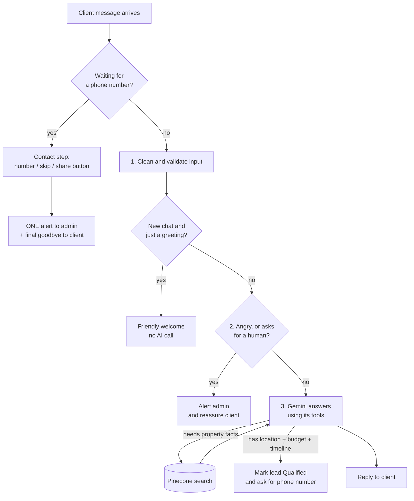
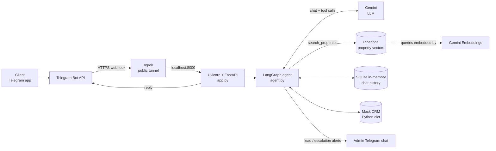

# Real Estate CX AI Agent

A customer-experience (CX) AI agent for real estate, built to run as the **front-facing assistant**
on a messaging channel. It answers buyer enquiries from a **verified property inventory**,
qualifies leads, and **hands off to a human advisor** at the right moment. This proof of concept
runs on **Telegram** and is demonstrated with a Dubai luxury property inventory. The channel and
inventory can be swapped for any agency.

---

## 1. Overview

**Use case:** first response and lead qualification for a real estate agency, available 24/7 in
English and Arabic.

What the agent does for the business:

- Greets clients and converses in **English or Arabic**.
- Quotes only properties and prices that exist in the inventory, so there is no guessing.
- Gathers the three qualifying details naturally: **location**, **budget** and **timeline**.
- Once all three are known, requests the client's phone number and alerts the sales team with the full lead details.
- Detects frustration or a request for a human and escalates immediately.
- Declines out-of-scope requests (legal, mortgage, visa and similar) politely and points to what it can help with.

The assistant introduces itself to clients as **Layla**. The persona name is set in the system
prompt in `agent.py` and can be changed freely.

### What it handles

| Situation | What the agent does |
|---|---|
| Greeting ("Hi", "مرحبا") | Warm welcome that explains how it can help (no AI call, so it is instant and costs nothing) |
| Property question | Looks it up in the inventory (Pinecone) and answers with real data |
| Nothing matches | Says so honestly and offers to check with the off-market team |
| Arabic or English | Replies in the language of the client's **latest** message |
| Client shares location + budget + timeline | Marks the lead **Qualified** and asks for a phone number |
| Phone number | Accepts `+971 50 123 4567`, `+971501234567`, `00971…`. Asks again if the **country code is missing**. Client can type "skip" |
| Frustration / "talk to a manager" | Instant human handoff and alert to the admin |
| Out-of-scope question | Polite redirect to what the agent can help with |

---

## 2. How it works

### The conversation flow



The safety checks (steps 1 and 2) are plain code, not AI, so they run on **every** message and
the AI cannot skip them.

### The system map (who talks to whom)



---

## 3. Tech stack

| Piece | Technology | Role |
|---|---|---|
| Chat channel | **Telegram Bot API** | Where clients (and the admin) talk to the bot |
| Public tunnel | **ngrok** | Gives your laptop a public HTTPS URL so Telegram can reach it |
| Web server | **Uvicorn + FastAPI** | Receives webhooks, returns replies |
| Agent workflow | **LangGraph** | Fixed step-by-step graph (guardrails → AI → qualification) |
| LLM | **Google Gemini** (model set in `.env`) | Writes replies and decides when to use tools |
| Embeddings | **gemini-embedding-001** (768 dims) | Turns text into vectors for search. Multilingual, so Arabic questions find English listings |
| Inventory store | **Pinecone** (serverless) | Holds the property listings as vectors |
| Chat memory | **SQLite** (in memory) | Remembers the conversation |
| Lead records | **Python dict** ("Mock CRM") | Stands in for a real CRM |

---

## 4. Where data lives

| Data | Where | Survives a restart? |
|---|---|---|
| Property listings (14 mock properties) | **Pinecone**, loaded by `seed_pinecone.py` | Yes |
| Conversation history | **SQLite in memory**, keyed by Telegram chat ID. The last 20 messages are sent to Gemini each turn | **No** |
| Lead records (location, budget, timeline, phone) | **In-memory dict** | **No** |

Notes:
- Clearing the chat **inside Telegram** does *not* clear the server's memory. the agent still remembers the conversation.
- Restarting `uvicorn` wipes history and leads. For a real deployment, point `SQLITE_DB_PATH` at a file and move the CRM to a database.
- Logs never contain message text (privacy by design).

---

## 5. Setup (run it locally)

You need: **Python 3.10+**, a **Google AI (Gemini) API key**, a **Pinecone** account, a **Telegram** account, and a free **ngrok** account.

### Step 1 — Install

```bash
python -m venv .venv
source .venv/bin/activate          # Windows: .venv\Scripts\activate
pip install -r requirements.txt
```

### Step 2 — Pinecone (inventory)

1. In the Pinecone console, create a **serverless index** with **dimension `768`** and metric **`cosine`**
   (name it `cx-ai-agent-realestate-leadqualifier`, or use your own name).
2. Copy the index **Host** URL from the index page.
3. The namespace is `__default__` (Pinecone's default; you can use your own).
4. Put these in `.env` (see Step 5): `PINECONE_API_KEY`, `PINECONE_INDEX_NAME`, `PINECONE_INDEX_HOST`, `PINECONE_NAMESPACE`.
5. Load the properties and confirm they arrived:

```bash
python seed_pinecone.py            # uploads 14 properties
python test_pinecone_direct.py     # should show vector_count: 14 in your namespace
```

### Step 3 — Telegram bot

Reference: <https://core.telegram.org/bots/api>

1. In Telegram, open **@BotFather** and send `/newbot`. Choose a name and a username ending in `bot`.
2. BotFather replies with a token like `123456:ABC-DEF…`. Save it as **`TELEGRAM_BOT_TOKEN`**.
3. Choose any random string (letters and numbers) for **`TELEGRAM_WEBHOOK_SECRET`**. It becomes part of your webhook URL so strangers can't post to it.

### Step 4 — Get the admin chat ID (who receives the alerts)

The admin is the person (or group) that should receive lead and escalation alerts.

1. From the **admin's Telegram account**, open your bot and press **Start**. *(The bot can't message anyone who hasn't started it.)*
2. In a browser, open (with your real token):
   `https://api.telegram.org/bot<YOUR_TOKEN>/getUpdates`
3. Find `"chat":{"id": 123456789 …}`. That number is **`TELEGRAM_ADMIN_CHAT_ID`**.

> Do this **before** registering the webhook (Step 7). Telegram refuses `getUpdates` while a webhook is active.
> Already set it? Run `https://api.telegram.org/bot<TOKEN>/deleteWebhook` first, or read the id from the ngrok inspector (<http://127.0.0.1:4040>).

### Step 5 — Create your `.env`

Copy `.env.example` to `.env` and fill it in:

```dotenv
# --- LLM ---
GOOGLE_API_KEY=
GEMINI_MODEL=                      # the Gemini model you use
GEMINI_TEMPERATURE=0.4
GEMINI_EMBEDDING_MODEL=gemini-embedding-001

# --- Pinecone ---
PINECONE_API_KEY=
PINECONE_INDEX_NAME=cx-ai-agent-realestate-leadqualifier
PINECONE_INDEX_HOST=
PINECONE_NAMESPACE=__default__

# --- Telegram ---
TELEGRAM_BOT_TOKEN=
TELEGRAM_ADMIN_CHAT_ID=
TELEGRAM_WEBHOOK_SECRET=

# --- Server / storage / guardrails ---
APP_HOST=0.0.0.0
APP_PORT=8000
WEBHOOK_VERIFY_TOKEN=dev-verify-token
SQLITE_DB_PATH=:memory:
SENTIMENT_ESCALATION_THRESHOLD=-0.4
MAX_MESSAGE_LENGTH=2000
```

The app won't start without: `GOOGLE_API_KEY`, `PINECONE_API_KEY`, `PINECONE_INDEX_HOST`, `TELEGRAM_BOT_TOKEN`, `TELEGRAM_ADMIN_CHAT_ID`.
Never commit `.env`. It is already in `.gitignore`.

### Step 6 — Start the server and the tunnel

Terminal 1:

```bash
uvicorn app:app --port 8000 --reload
```

Terminal 2 (first time only, add your ngrok token from the ngrok dashboard):

```bash
ngrok config add-authtoken <YOUR_NGROK_TOKEN>
ngrok http 8000
```

ngrok prints a URL like `https://abcd-1234.ngrok-free.app`. Copy it.

### Step 7 — Connect Telegram to your server

Open this in a browser (replace the three placeholders):

```
https://api.telegram.org/bot<TOKEN>/setWebhook?url=<NGROK_URL>/telegram-webhook/<WEBHOOK_SECRET>
```

You should see `"Webhook was set"`. To double-check: `https://api.telegram.org/bot<TOKEN>/getWebhookInfo`.

> Free ngrok gives a **new URL every restart**. Re-run Step 7 each time.

---

## 6. Testing

Open your bot in Telegram (as a normal client) and try these. Alerts appear in the **admin** chat.

| Say this | Expected result |
|---|---|
| `Hi` | Warm welcome, asks which area |
| `Do you have anything in Palm Jumeirah?` | The Frond D villa, with the price from Pinecone |
| Same question in Arabic | Arabic reply, same property |
| `Anything in Antarctica?` | Honest "no matching listing" message |
| `What's the mortgage rate?` | Polite "can't help with that, but I can help with…" |
| Give an area, a budget and a timeline | The agent asks for your phone number (with a share button) |
| `8484820346` (no country code) | Asks again, requesting the country code |
| `+91 84848 20346` | Goodbye message, **one** "NEW QUALIFIED LEAD" alert in admin chat |
| `skip` (instead of a number) | Alert shows `Client Phone: User refused` |
| `This is ridiculous, I want a manager` | Reassurance to client, "AI CIRCUIT BREAKER" alert to admin |

**Debugging tools**

- Health check: `curl http://localhost:8000/health`
- See every request Telegram sends: ngrok inspector at <http://127.0.0.1:4040>
- Test without Telegram (generic endpoint):
  ```bash
  curl -X POST http://localhost:8000/webhook -H "Content-Type: application/json" \
    -d '{"phone_number":"+971501234567","message":"Anything on Jumeirah Bay Island?"}'
  ```

**Alert format (what your team sees)**

```
🎯 NEW QUALIFIED LEAD ENRICHED
• Client Phone: +918484820346
• Client Username and ID: Nikhil Kumar Nayak (@Sknowchild) [ID: 1303306155]
• Target Location: Downtown Dubai
• Verified Budget: 28500000 AED
• Purchase Timeline: Within 1 month
```

---

## 7. Project files

```
.
├── app.py                   # FastAPI server: Telegram webhook + /webhook + /health
├── agent.py                 # The brain: LangGraph steps, Gemini tools, alerts, phone step
├── database.py              # SQLite history, Pinecone search, mock CRM, phone validation
├── config.py                # Reads .env, safety thresholds, handoff keywords
├── seed_pinecone.py         # Loads the 14 mock properties into Pinecone
├── test_pinecone_direct.py  # Quick check that Pinecone is reachable and seeded
├── requirements.txt
└── .env.example
```

---

## 8. Known limitations (POC)

- Chat history and leads are in memory and reset on restart.
- The CRM is a mock; swap it for a real one (HubSpot, Salesforce…) for production.
- The sentiment guardrail is a simple word-list check, chosen for speed and zero cost.
- One server process; no queueing or duplicate-message protection yet.
- Free ngrok URLs change on every restart.

## 9. Troubleshooting

| Problem | Check |
|---|---|
| Bot never replies | `getWebhookInfo`. Is the URL current? Any `last_error_message`? |
| App crashes on start | A required `.env` value is missing (the error names it) |
| "No listing found" for everything | Run `python test_pinecone_direct.py`. Is the count 14 in the right namespace? |
| No alerts arrive | Did the admin press **Start** on the bot? Is `TELEGRAM_ADMIN_CHAT_ID` correct? |